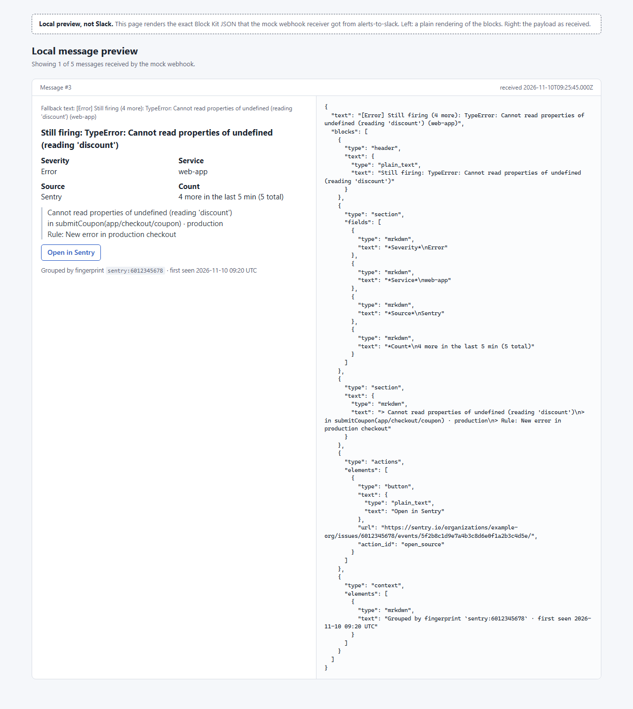

# alerts-to-slack

[](https://github.com/fatih255/alerts-to-slack/actions/workflows/ci.yml)

Turns CloudWatch alarms (via SNS) and Sentry issue alerts into grouped, readable Slack messages, as a Lambda handler or a local HTTP server.



The screenshots are a local preview page served by the mock webhook receiver. It renders the exact JSON the service posted. It isn't Slack.

## Why this exists

At Popupsmart I worked on moving our AWS log visualization from Sentry to Grafana and sent CloudWatch alerts to Slack, so we'd hear about problems sooner. With Customer Success I followed a simple routine for bug reports: reproduce it first, tell them before the hotfix, tell them again when the fix is live, and explain it if it turns out to be a usage error. This repo is a small from-scratch version of that alert pipeline, not the production code. More on that work at [fatihinci.com/experience](https://fatihinci.com/experience/#operations).

## What it shows

- Parsers for the SNS envelope (notification, subscription confirmation), CloudWatch alarm state changes (ALARM, OK, INSUFFICIENT_DATA) and Sentry integration webhooks (`event_alert` triggered, `issue` resolved). Fixtures in [`fixtures/`](fixtures) follow the documented payload shapes with made-up values.
- One normalized alert model: source, status, severity, service, title, summary, link, fingerprint.
- Grouping by fingerprint behind a small `AlertStore` interface. The first alert posts right away, repeats inside the window are counted, and the next message says "4 more in the last 5 min". A flush (a timer locally, an EventBridge schedule in Lambda) posts counts that would otherwise wait. OK or resolved posts a follow-up with how long it was open.
- Block Kit messages with severity, service, a quoted summary, an "Open in Sentry/CloudWatch" button and a short triage line on new alerts.
- Request checks: a shared secret on `/sns` (`X-Alert-Secret` header, or Basic auth, which SNS can send), `Sentry-Hook-Signature` HMAC on `/sentry`, and SubscribeURLs are only followed if they point at an SNS host.
- State is saved only after Slack accepts the message. If the webhook fails the service answers 502, so SNS or Sentry retries.

## Run it

```sh
npm install
npm run dev     # service on :3501, mock Slack webhook + preview on :3502
npm run demo    # in a second terminal: sends the fixtures through the service
```

Open http://127.0.0.1:3502/ to see what the mock webhook received. `npm run dev` uses a 10 second grouping window so the demo finishes quickly; the service default is 300. Settings are listed in [`.env.example`](.env.example).

`npm run screenshots` starts its own copy on ports 3503 and 3504, runs the demo and saves `docs/screenshots/*.png` with Playwright.

For Lambda, `npm run build` writes `dist/`. The handler is `lambda.handler`; it takes Function URL or API Gateway HTTP API (v2) events, and scheduled EventBridge events trigger the flush. The output is ES modules, so ship it with this `package.json` or bundle it.

## Tests

```sh
npm test
```

Vitest covers the parsers against the fixtures, grouping windows with fake timers (boundaries, flush, separate fingerprints, a failed post), the resolved flow, Block Kit snapshots and escaping, the secret and signature checks, and end-to-end HTTP runs from the test through the real server to the mock webhook, including the Lambda handler. CI runs lint, typecheck, build and tests.

## Limits

- Only an in-memory store. In Lambda that means grouping only covers one warm container. A DynamoDB store would fit the `AlertStore` interface, but it isn't here because I haven't built and tested one.
- SNS message signatures (the `Signature` and `SigningCertURL` fields) aren't verified. The shared secret is the only check on `/sns`.
- Incoming webhooks can't edit messages, so a repeat is a new message rather than an updated count on the first one.
- Sentry metric alerts and other Sentry resources are acknowledged and ignored.

## License

MIT, see [LICENSE](LICENSE).
